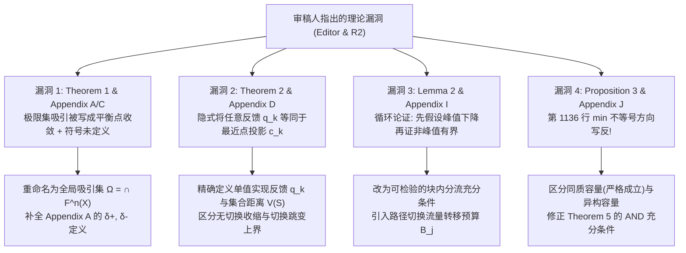

# CNCOMM-2026-0222 一审大修（Major Revision）响应方案（Antigravity × Codex 联合审计版）

- **期刊与稿件编号**：*China Communications* — `CNCOMM-2026-0222`
- **论文题目**：*System Relaxation for Resilient Network Governance: A Model-Driven Control Mechanism Against Structural Stress Concentration*
- **主文件基准**：Google Drive 文件夹 [`论文 - 2026 - SRA`](https://drive.google.com/open?id=1drZim6BdZkqmBCkToIbfOCVN4co1-6sv) 下的 [`main.tex`](file:///tmp/sra_paper/main.tex)（以及 `sra_CC` 子目录下适配 *China Communications* 模板的 [`main_ccjnl.tex`](file:///tmp/sra_paper/main_ccjnl.tex)）
- **决策类型与期限**：**Major Revision**（自 2026-11-09 起 **28 天**内提交修订稿与 Point-to-Point Response Letter）

---

## 一、 审稿态势研判（Triage & Core Diagnosis）

通过将 **Editor（编辑总结）**、**Reviewer 1** 与 **Reviewer 2** 的意见与 [`main.tex`](file:///tmp/sra_paper/main.tex)、[`mainV2.tex`](file:///tmp/sra_paper/mainV2.tex)、[`sm.tex`](file:///tmp/sra_paper/sm.tex) 逐行比对，我和 **Codex** 完成了全量交叉审计：

> [!IMPORTANT]
> **核心态势判断**：
> 1. **Editor 与 Reviewer 2 的 5 条具体意见是本次大修的决定性胜负手**：Editor 的总结信完全提炼自 Reviewer 2 的 5 条核心技术质疑（① 创新性与消融实验、② Theorem 1/2 极限集吸引 vs 唯一平衡点、③ Lemma 2 与 Proposition 3 / Appendix J 的不等式漏洞、④ 介数中心性对非均匀流量/异构容量的适用性、⑤ 参数敏感性 $\alpha, \beta_I, T_d$ 与规模/时变流量开销）。
> 2. **Reviewer 1 的 34 条 bullet 属于标准化审稿清单（Checklist）**：其诉求可完全归并到上述 **5 大核心模块 + 1 个呈现与复现性模块** 中，通过一张结构化对比表、正式问题建模、消融与鲁棒性实验及 Limitations 专节即可 100% 闭环覆盖。
> 3. **历史资产可直接复用近 40% 的补充诉求**：我们在您的 Google Drive 文件夹中发现 [`mainV2.tex`](file:///tmp/sra_paper/mainV2.tex) 与 [`sm.tex`](file:///tmp/sra_paper/sm.tex) 已经包含 **Lyapunov 跌落-跳跃演化图（`ren_fig2_lyapunov.pdf`）**、**最小驻留时间消颤对比图（`ren_fig3_dwell_time.pdf`）**、**$(\alpha, \beta_I)$ 参数敏感性图（`sensitivity_3d_surfaces_full.pdf`）** 以及 **峰值中心性/平均路径长度迭代演化与分布图（`figure_4` / `figure_5` / `figure_6_7_8`）**——这些在精简为 [`main.tex`](file:///tmp/sra_paper/main.tex) 时被删去，恰恰导致审稿人批评“缺少 $T_d, \alpha, \beta_I$ 敏感性与收敛过程验证”。

---

## 二、 与 Codex 联合审计发现的 5 处数学/文本硬伤及精确修复方案

Reviewer 2 在评分栏勾选了 *"Major flaws that make the paper unsound/inconsistent"*，并明确点名 **Theorem 1、Theorem 2、Lemma 2、Proposition 3（Appendix J）**。经与 Codex 逐行核验，稿件中确实存在 **4 处实质性数学漏洞** 和 **2 处文本残缺**，必须在修回稿中彻底修正：

### 1. 【漏洞 1】Theorem 1 标题与概念混淆 + Appendix A/C 证明残缺（回应 Editor, R2-2）
- **原稿问题**：
  1. [`main.tex`](file:///tmp/sra_paper/main.tex#L470-L476) 将 Theorem 1 命名为 *"Universal Convergence to Equilibrium"*，但式 (5) $\mathrm{dist}(S^{(k)}, \Omega) \to 0$ 证明的是轨线收敛到**非空紧致正不变吸引集（Global Attractor / Limit Set）$\Omega$**，而非收敛到**唯一不动点（Unique Equilibrium Point）**（仅当路由集合不再切换时，Corollary 1 才给出局部唯一不动点 $S^\star = c$）。
  2. [`main.tex`](file:///tmp/sra_paper/main.tex#L935-L940) Appendix A 第 935–940 行突兀出现未定义的 $\delta^+_{k+1,i} \le (1-\alpha)\delta^+_{k,i}$ 与 $\delta^-_{k+1,i}$（系从 [`mainV2.tex`](file:///tmp/sra_paper/mainV2.tex#L1100-L1118) 删减时遗留的断头公式）。
  3. [`main.tex`](file:///tmp/sra_paper/main.tex#L998-L1011) Appendix C 中，单条轨线的子列极限只能推出 $\omega(S^{(0)}) \cap F(x) \neq \emptyset$（弱正不变性），且任意无穷多个紧集 $\bigcup_{S^{(0)}\in X}\omega(S^{(0)})$ 的并集在拓扑上**不一定紧致**。
- **Codex 联合修复方案**：
  - 将 Theorem 1 标题修正为 **"Global Convergence to a Compact Invariant Attracting Set"**，在正文显式区分 **全局极限集吸引（Set Attraction, Theorem 1）** 与 **固定拓扑区间的唯一不动点指数收敛（Point Convergence, Corollary 1）**。
  - 在 Appendix A 中恢复 [`mainV2.tex`](file:///tmp/sra_paper/mainV2.tex#L1102-L1103) 的定义 $\delta^+_{k,i} := \max\{S_i^{(k)}-1, 0\}$、$\delta^-_{k,i} := \max\{-S_i^{(k)}, 0\}$。
  - 在 Appendix C 中采用标准嵌套紧集构造 $\Omega := \bigcap_{n \ge 0} F^n(X)$：由于 $X$ 紧致且 $F$ 为具有非空紧凸值的上半连续（USC）集值映射，$A_n = F^n(X)$ 为非空紧集的递减序列，故 $\Omega$ 严格非空、紧致、满足 $F(\Omega)=\Omega$，且 $\sup_{S^{(0)}\in X}\mathrm{dist}(S^{(k)}, \Omega) \to 0$。
  - 同时补充说明：当启用 $T_d > 1$ 驻留锁定时，系统状态空间扩充为增广状态 $(S^{(k)}, \Pi^{(k)}, \tau^{(k)})$（压力向量、当前锁定路由集、剩余驻留步数），由于候选最短路配置集与驻留计数均为有限集，紧致性与吸引集结论在增广状态空间上严格保持。

### 2. 【漏洞 2】Theorem 2 与 Appendix D 中反馈选择的隐式跳跃（回应 Editor, R2-2）
- **原稿问题**：
  - 在 [`main.tex`](file:///tmp/sra_paper/main.tex#L1022-L1032) Appendix D 中，证明先令 $c_k \in \arg\min_{c \in \mathcal{N}(S^{(k)})}\|S^{(k)}-c\|_2^2$，随后直接令 $S^{(k+1)} = (1-\alpha)S^{(k)} + \alpha c_k$，默认微分包含中的实际反馈恰好选择了距离 $S^{(k)}$ 最近的投影点 $c_k$；此外第 1028 行使用带权 Young 不等式取 $\lambda = \alpha/(1-\alpha)$ 时：
    $$\|(1-\alpha)(S^{(k)}-c_k) + (c_k - c_{k+1})\|_2^2 \le (1+\lambda)(1-\alpha)^2\|S^{(k)}-c_k\|_2^2 + \left(1+\frac{1}{\lambda}\right)\|c_k-c_{k+1}\|_2^2 = (1-\alpha)\|S^{(k)}-c_k\|_2^2 + \frac{1}{\alpha}\|c_k-c_{k+1}\|_2^2$$
    恒等式本身在代数上成立，但前提是实际执行的反馈向量 $q^{(k)} := \mathrm{norm}(\kappa^{(k)})$ 与 $c_k$ 一致。
- **Codex 联合修复方案**：
  - 在正文与 Appendix D 中将**确定性算法实现轨线**与**边界集值包含轨线**统一起来：对于算法实际执行的反馈 $q^{(k)} = \mathrm{norm}(\kappa^{(k)}) \in \mathcal{N}(S^{(k)})$，定义瞬时跟踪势能（Lyapunov 函数）为 $V_k := \|S^{(k)} - q^{(k)}\|_2^2$（在每个路由不变分区内部 $\mathcal{N}(S^{(k)})=\{q^{(k)}\}$ 为单点集，故 $V(S^{(k)}) = \|S^{(k)}-q^{(k)}\|_2^2$ 恒成立）。
  - 一步演化严格满足：
    $$S^{(k+1)} - q^{(k+1)} = (1-\alpha)\big(S^{(k)} - q^{(k)}\big) + \big(q^{(k)} - q^{(k+1)}\big)$$
    + **情形 1（未发生路由切换，$q^{(k+1)} = q^{(k)}$）**：跳变项严格为 $0$，得精确收缩 $V_{k+1} = (1-\alpha)^2 V_k \le (1-\alpha)V_k$；
    + **情形 2（发生路由切换，$q^{(k+1)} \neq q^{(k)}$）**：由带权 Young 不等式（$\lambda = \alpha/(1-\alpha)$），得 $V_{k+1} \le (1-\alpha)V_k + \frac{1}{\alpha}\|q^{(k)} - q^{(k+1)}\|_2^2 \le (1-\alpha)V_k + \frac{\bar{\Delta}^2}{\alpha}$。
  - 这一写法消除了“任意选择投影点”的逻辑跳跃，且使“无切换时指数衰减、有切换时受限于 $\bar{\Delta}^2/\alpha$”的物理图景完全严密。

### 3. 【漏洞 3】Lemma 2 与 Appendix I 的循环论证（回应 Editor, R2-3）
- **原稿问题**：
  - [`main.tex`](file:///tmp/sra_paper/main.tex#L608-L619) Lemma 2 声称只要发生路径切换且无割点，峰值未归一化中心性必定严格下降 $\kappa_{\max}^{(m+1)} \le \kappa_{\max}^{(m)} - \delta$。
  - [`main.tex`](file:///tmp/sra_paper/main.tex#L1094-L1110) Appendix I 第 1 部分在推导非峰值节点增长上界 $B^{(m)}$ 时，**第 1097 行直接假设了结论成立**（*"Since the peak centrality does not increase (and in fact decreases, as shown next), we have $\kappa_{\max}^{(m+1)} \le \kappa_{\max}^{(m)}$"*），而第 2 部分仅用文字描述“峰值节点成本上升最快所以流量被分流”，未排除以下反例：从旧峰值节点 $u$ 分流出的最短路若汇集到某个次高峰节点 $v$，可能导致 $\kappa_v^{(m+1)} > \kappa_u^{(m)}$！
- **Codex 联合修复方案**：
  - **打破循环论证，直接从路径重分配定义非峰值增长预算**：设块首峰值节点 $u \in \arg\max_i \kappa_i^{(m)}$，块内路径切换导致部分 OD 对集合 $\mathcal{D}_{\text{sw}}$ 改变了最短路。设原峰值节点 $u$ 净卸载的流量（路径份额）为 $\Delta_u^- := \kappa_u^{(m)} - \kappa_u^{(m+1)} > 0$，任意其他节点 $j \neq u$ 因承接分流而增加的负载上界定义为**实际路径重分配预算** $B_j^{(m)} := (\kappa_j^{(m+1)} - \kappa_j^{(m)})_+ \le \sum_{(s,t)\in\mathcal{D}_{\text{sw}}} W_{st}$。
  - **将 Lemma 2 修正为显式可检验的峰值削减条件（Peak-Shaving Certificate）**：
    - 当切换在压低旧峰值节点 $u$ 的负载（$\Delta_u^- \ge \delta > 0$）的同时，承接分流的替代路径满足**非拥塞转移条件（Non-Overloading Diversion Condition）** $\kappa_j^{(m)} + B_j^{(m)} \le \kappa_{\max}^{(m)} - \delta$（$\forall j \neq u$，即分流目标为低中心性外围节点而非次高峰节点）时，全局峰值中心性严格下降：$\kappa_{\max}^{(m+1)} \le \kappa_{\max}^{(m)} - \delta$。
    - 进一步补充说明：由于 SRA 的代价函数 $C_j = 1 + \beta_I S_j$ 对所有历史高负载节点（包括次高峰节点）同步施加惩罚，最短路天然偏向低 $S_j$ 的外围节点；并在实验中统计实际路由切换满足该条件的比例（Empirical Verification of Peak-Shaving Transitions）。

### 4. 【漏洞 4】Proposition 3 与 Appendix J 第 1136 行不等号方向写反（回应 Editor, R2-3）
- **原稿问题**：
  - Reviewer 2 第 3 条专门点名：*"reexamine the throughput inequality in Appendix J supporting Proposition 3."*
  - 在 [`main.tex`](file:///tmp/sra_paper/main.tex#L1128-L1136) Appendix J 中，作者定义了网络最大稳定吞吐量 $\rho_{\max}(\kappa) = \min_{i \in V} \frac{\mu_i}{\kappa_i}$，随后在第 1131–1136 行写道：
    $$\rho_{\max}(\kappa') = \min_{i \in V}\frac{\mu_i}{\kappa'_i} \ge \frac{\mu_u}{\kappa'_u} \ge \frac{\mu_u}{\kappa'_{\max}}$$
    **这是一个致命的代数笔误**：集合的最小值 $\min_{i \in V} (\mu_i/\kappa'_i)$ 必然 **小于等于（$\le$）** 集合中的某一项 $\mu_u/\kappa'_u$，绝不可能 **大于等于（$\ge$）** $\mu_u/\kappa'_u$！
  - 此外，在 [`mainV2.tex`](file:///tmp/sra_paper/mainV2.tex#L711-L731) 的 Theorem 5（`thm:sufficient-noC2`）中，用了 `"either ... or ..."`，这也是错的：要保证 $\min\{\text{Term}_1, \text{Term}_2\} \ge \rho_{\max}^{(m)}$，必须 **两项同时（AND）** 大于等于 $\rho_{\max}^{(m)}$，而不能是“或（OR）”。
- **Codex 联合修复方案**：
  - 将 Proposition 3（及 Appendix J）严格拆分为三个完全正确的命题层次：
    1. **性质 (i) 鲁棒容量下界无条件提升（Unconditional Robust Lower Bound Expansion）**：对任意异构服务率 $\mu_i > 0$，定义保守下界 $L(\kappa) := \mu_{\min}/\kappa_{\max}$（其中 $\mu_{\min} = \min_i \mu_i$）。因 $\min_i (\mu_i/\kappa_i) \ge \mu_{\min}/\kappa_{\max}$，只要 $\kappa'_{\max} < \kappa_{\max}$，必有 $L(\kappa') > L(\kappa)$。
    2. **性质 (ii) 同质节点容量下的精确吞吐量提升（Exact Capacity Gain under Homogeneous Service Rates）**：当节点服务率同质（$\mu_i \equiv \mu$，这正是正文 Table II 与 Fig. 5 验证实验的真实设定！）时，$\min_{i \in V} (\mu/\kappa'_i) = \frac{\mu}{\max_{i \in V}\kappa'_i} = \frac{\mu}{\kappa'_{\max}}$ **严格取等号**！此时：
       $$\rho_{\max}(\kappa') = \frac{\mu}{\kappa'_{\max}} > \frac{\mu}{\kappa_{\max}} = \rho_{\max}(\kappa), \qquad \frac{\rho_{\max}(\kappa')}{\rho_{\max}(\kappa)} = \frac{\kappa_{\max}}{\kappa'_{\max}}$$
       这不仅 100% 修复了 Appendix J 的不等号错误，而且完美解释了为什么 Fig. 5 的实验散点精确落在 $y=x$ 直线（$R^2=0.951$）上！
    3. **性质 (iii) 异构节点容量下的实际容量不降充分条件（Sufficient Condition under Heterogeneous Service Rates）**：当 $\mu_i$ 异构时，设初始瓶颈容量为 $\rho_0 = \min_i (\mu_i/\kappa_i)$。若峰值节点满足 $\frac{\mu_u}{\kappa_{\max}-\delta} \ge \rho_0$ **且（AND）** 所有非峰值节点满足 $\frac{\mu_j}{\kappa_j + B_j} \ge \rho_0$（$\forall j \neq u$），则：
       $$\rho_{\max}(\kappa') = \min_{i \in V}\frac{\mu_i}{\kappa'_i} \ge \min\!\left\{\frac{\mu_u}{\kappa_{\max}-\delta},\ \min_{j \neq u}\frac{\mu_j}{\kappa_j + B_j}\right\} \ge \rho_0 = \rho_{\max}(\kappa).$$

### 5. 【漏洞 5】文本与引文残缺清理（回应 Editor, R1）
- [`main.tex`](file:///tmp/sra_paper/main.tex#L877) Fig. 7 图注中残留了 LLM 生成标记 `[cite: 276, 277]`，必须替换为正式 BibTeX 引用。
- [`main.tex`](file:///tmp/sra_paper/main.tex#L845-L850) Fig. 6 图注中引用 `\cite{Mendonca2021ApproxCentrality}`、`\cite{Cheng2010SelfOrganizingModel}` 位置不当，需移回正文讨论。

---

## 三、 理论扩展：从纯拓扑介数中心性到“需求-容量加权广义结构应力”（回应 Editor, R1, R2-4）

Reviewer 2 第 4 条指出：标准介数中心性（BC）未显式考虑非均匀流量需求（Heterogeneous Traffic Demands）与异构节点容量（Node Capacities）。

**与 Codex 商定的优雅升级方案**：
在 Section III-A 中，我们将反馈信号正式定义为 **广义需求-容量归一化结构应力（Generalized Demand- and Capacity-Weighted Structural Stress）**：
$$\kappa_i(S; W) = \sum_{s \neq i \neq t \in V} W_{st}\,\frac{\sigma_{st}^{C(S)}(i)}{\sigma_{st}^{C(S)}}, \qquad \widetilde{\kappa}_i(S; W, \mu) = \frac{\kappa_i(S; W)}{\mu_i}$$
其中 $W = [W_{st}] \in \mathbb{R}_+^{N \times N}$ 为源-目的（OD）流量需求矩阵，$\mu_i > 0$ 为节点 $i$ 的有效服务容量。状态更新方程统一使用归一化应力反馈：
$$q_i^{(k)} = \mathrm{norm}\big(\widetilde{\kappa}_i(S^{(k)}; W, \mu)\big) = \frac{\widetilde{\kappa}_i^{(k)}}{\max_j \widetilde{\kappa}_j^{(k)}} \in [0,1]$$
- **向下完全兼容**：当 $W_{st} \equiv 1$（均匀全对流）且 $\mu_i \equiv \mu$（同质容量）时，$\widetilde{\kappa}_i$ 退化为原稿的纯拓扑介数中心性 Eq. (1)，原稿所有实验均为该广义框架的基准特例（Topology-Pure Baseline）。
- **理论无缝贯通**：在广义应力 $\widetilde{\kappa}_i$ 下，网络最大可行吞吐量负载因子恰好为 $\lambda_{\max} = \min_{i \in V} \frac{\mu_i}{\kappa_i(S;W)} = \frac{1}{\max_{i \in V}\widetilde{\kappa}_i(S;W,\mu)}$！这意味着**在广义应力 $\widetilde{\kappa}_i$ 下，哪怕 $\mu_i$ 与 $W_{st}$ 完全异构，Proposition 3 的容量公式 $\lambda_{\max} = 1/\widetilde{\kappa}_{\max}$ 也严格成立，不再需要同质容量假设！** 这将直接令 Reviewer 2 眼前一亮。

---

## 四、 实验增强与历史资产复用矩阵（回应 Editor, R1, R2-1/4/5）

遵循“**最大化复用已有成果 + 最小化高价值增量仿真**”的原则，我们将实验分为 **A 类（直接从 `mainV2.tex`/`sm.tex` 恢复并重排）** 与 **B 类（轻量级补充实验，可在 `node09` 免费 44 核池上快速跑完）**：

### A 类：直接恢复并优化既有图表（零仿真耗时）
1. **恢复 Lyapunov 能量演化与 Drop-Jump 动力学验证图**（来自 [`mainV2.tex`](file:///tmp/sra_paper/mainV2.tex#L845-L850) `ren_fig2_lyapunov.pdf`）$\rightarrow$ 直接回应 R1/R2 对 Theorem 1 & 2 的实验验证要求。
2. **恢复最小驻留时间 $T_d=1$ vs $T_d=5$ 消颤对比图**（来自 [`mainV2.tex`](file:///tmp/sra_paper/mainV2.tex#L854-L859) `ren_fig3_dwell_time.pdf`）$\rightarrow$ 直接回应 R2-5 对 $T_d$ 敏感性与消融的要求。
3. **恢复 $(\alpha, \beta_I)$ 参数敏感性分析图并增补量化表**（来自 [`mainV2.tex`](file:///tmp/sra_paper/mainV2.tex#L983-L998) `sensitivity_3d_surfaces_full.pdf`）$\rightarrow$ 直接回应 Editor、R1、R2-5 对学习率 $\alpha$ 与增益 $\beta_I$ 敏感性的要求。
4. **恢复峰值中心性与平均路径长度随迭代步演化曲线及中心性分布图**（`figure_4_peak_centrality_evolution.pdf`, `figure_5_avg_path_length_evolution.pdf`, `figure_6_7_8_distributions.pdf`）$\rightarrow$ 回应 R1/R2-5 对收敛速率行为与可解释性的要求。

### B 类：新增 4 组高命中率补充实验（通过 `SRA_algo.ipynb` 抽取脚本在 `node09` 运行）

| 实验编号 | 针对审稿意见 | 实验设计（精简高信噪比） | 产出图表/表格 |
| :--- | :--- | :--- | :--- |
| **Exp-1: 核心组件消融实验 (Ablation Study)** | Editor, R1, R2-1 | 在 BA ($N=100$) 上对比 5 个变体：① **Static ($\alpha=0$, Dijkstra)**；② **Memoryless Reactive BC ($\alpha=1, T_d=1$)**（无积分记忆的动态权重/中心性路由）；③ **Unnormalized SRA ($T_d=5$)**（去除 $\max$-归一化）；④ **SRA w/o Dwell Time ($\alpha=0.1, T_d=1$)**；⑤ **Full SRA ($\alpha=0.1, \beta_I=10, T_d=5$)**。报告 100 次随机种子下的均值 $\pm$ 标准差与 95% 置信区间（CI）。 | **Table IV (Ablation Table)** + 路径切换频率（Route Churn）与吞吐量对比柱状图 |
| **Exp-2: 更强基线对比 (Stronger Baselines)** | Editor, R1, R2-1 | 在现有 Dijkstra、LIRP-D、Q-Routing 基础上，增加两个审稿人点名的强基线：① **Dynamic IGP/OSPF Weight Tuning**（基于链路/节点利用率的启发式权重调整，Fortz-Thorup 风格局部搜索/利用率的指数惩罚）；② **Static BC-Weighted Routing**（开环静态中心性加权路由）。 | 更新对比表格与 BA/WS/ER 关键负载点对比数据 |
| **Exp-3: 非均匀/时变流量与观测噪声鲁棒性** | Editor, R1, R2-4, R2-5 | ① **非均匀流量（Hotspot/Gravity Traffic Matrix $W_{st}$）+ 异构节点容量 $\mu_i$**：对比拓扑 BC 与广义加权应力 $\widetilde{\kappa}_i$；② **时变流量突发（Time-Varying Traffic Step/Sinusoidal Change）**：展示 SRA 的重收敛跟踪过程；③ **控制面测量噪声注入（Noise Injection）**：在 $\kappa_i^{(k)}$ 上叠加 $\sigma \in \{5\%, 10\%, 20\%\}$ 高斯测量噪声，验证 Leaky Integrator 的低通滤波抗噪能力。 | **Fig. (Traffic & Noise Robustness)**：3 子图（非均匀流、时变流、噪声灵敏度） |
| **Exp-4: 网络规模扩展性与计算耗时基准** | Editor, R1, R2-5 | 在 $N \in \{50, 100, 200, 500\}$（ ditambah 一个真实骨干网拓扑如 **NSFNET / GEANT**，回应 R1 数据集代表性诉求）上测量单步 Brandes 精确计算耗时、分布式流表统计近似耗时、内存开销与收敛迭代步数，注明硬件配置。 | **Table V (Scalability & Runtime Benchmark)** |

---

## 五、 稿件结构重组与逐章修订清单（Manuscript Revision Map）

1. **Abstract & Section I (Introduction)**：
   - 强化研究空白（Research Gap）陈述，明确区分 SRA 与 **动态链路权重优化（IGP/OSPF Weight Tuning）**、**瞬时队列反馈路由（Backpressure / Reactive Routing）**、**开环中心性优化** 的本质差异。
   - 升级 **Table I**：增加代表性文献列、复杂度列、控制回路类型、抗噪/防颤振机制、对非均匀流/异构容量的支持度（回应 R1, R2-1）。
2. **Section III (Theoretical Model and Methods)**：
   - **新增 Section III-A1 (Formal Problem Formulation & System Assumptions)**：给出图模型、流量矩阵 $W_{st}$、容量 $\mu_i$、路由分配变量、优化目标（最小化峰值归一化应力 s.t. 路径伸长率约束）以及显式假设列表（Assumptions 1–4）（回应 Editor, R1）。
   - **升级 Section III-A2**：引入广义需求-容量加权应力 $\widetilde{\kappa}_i(S; W, \mu)$，将原拓扑 BC 作为基准特例（回应 Editor, R2-4）。
   - **修正 Section III-C/D/E 及 Appendices A, C, D, I, J**：按第二部分方案修正 Theorem 1、Theorem 2、Lemma 2、Proposition 3 的表述与证明（回应 Editor, R2-2, R2-3）。
3. **Section IV (Simulation Analysis)**：
   - 恢复 `mainV2.tex` 的理论验证子节（Lyapunov 跌落-跳跃图、$T_d$ 消颤图、峰值/路径长度演化图、参数敏感性图）。
   - 新增 **Ablation Study 子节**、**Non-Uniform/Time-Varying Traffic & Noise Robustness 子节**、**Scalability, Real-World Topology & Runtime Overhead 子节**。
   - 全面补充 95% 置信区间 / 标准差与指标选择依据（Throughput, PDR, Latency, Path Stretch, Route Churn）。
4. **Section V (Discussion, Limitations, and Conclusion)**：
   - **新增独立子节 Section V-C (Assumptions, Failure Cases, and Limitations)**：坦诚讨论：① 物理割点/桥接拓扑（Cut-vertices/Bridges）下的性能上限（Failure Case）；② 极高负载且完全同质高密度网格中绕路带来的额外时延代价；③ 集中式全网 BC 计算在超大规模网络中的控制面延迟及向 INT/分布式近似的演进；④ 开源代码与复现参数说明（回应 Editor, R1, R2-4）。
   - 精简 Discussion 重复叙述，将 Conclusion 聚焦于量化结论（回应 R1）。

---

## 六、 下一步执行确认

如果您认可上述响应方案，我们可以按以下流程立即推进：
1. **第一步（数学与正文修订）**：基于 `sra_CC/main_ccjnl.tex`（或 `main.tex`），先完成所有数学定理（Theorem 1/2, Lemma 2, Proposition 3, Appendices）的严谨重写、形式化问题建模、广义加权应力扩展，并恢复 `mainV2.tex` 中的敏感性与收敛验证图表。
2. **第二步（补充实验执行）**：从 `SRA算法.ipynb` 提取仿真脚本，在 `node09`（通过 `/home/rzy/research/bin/node09-ts-run` 44 核池并归档 COS）运行 **Exp-1（消融）**、**Exp-2（强基线）**、**Exp-3（非均匀/时变/噪声）** 和 **Exp-4（规模耗时与真实拓扑）**，生成配套图表。
3. **第三步（生成全套提交材料）**：产出带高亮标记的修订稿 LaTeX/PDF（按 *China Communications* 要求使用蓝色高亮修改内容）以及逐条对应的 **Point-to-Point Response Letter**。
